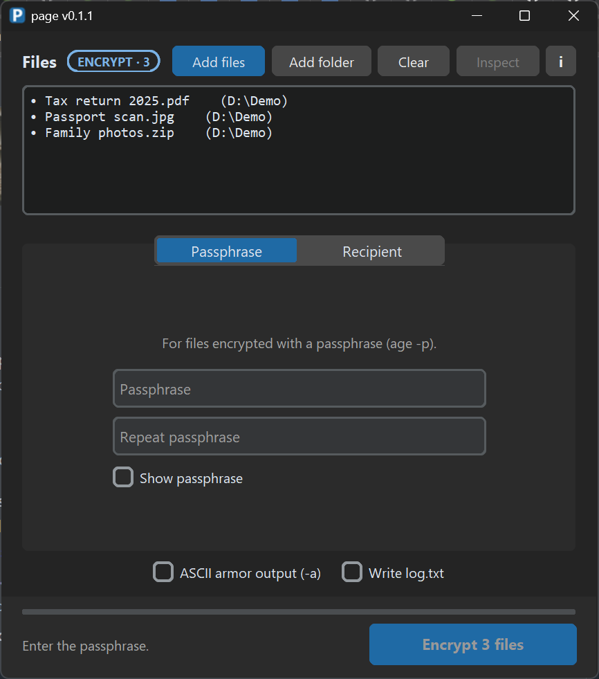
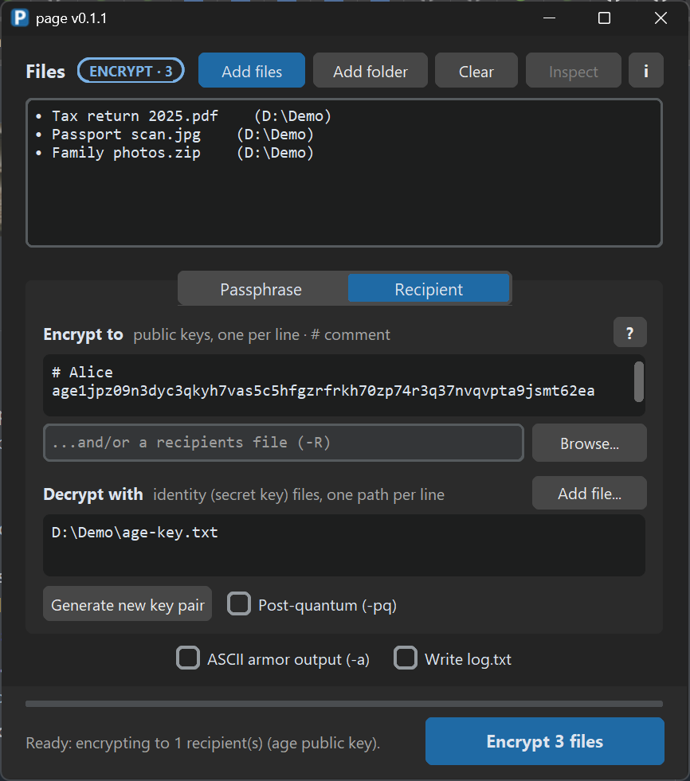

<p align="center">
  
</p>

# page v0.1.1

> [!TIP]
> **Use [sage](https://github.com/t0ma5/sage) instead.** sage is the same app, made by the same author, as a single exe with the official age library built in: no separate age tools to keep next to it, and it is where new features go. page stays available and gets fixes, but no new features.

**page** = **P**ython GUI for **age**. A small window for encrypting and decrypting files with [age](https://age-encryption.org) on Windows.

- **Portable: one folder, nothing to install.** Unzip it anywhere (a USB stick works) and run `page.exe`. The folder holds page and the official age tools (`age.exe`, `age-keygen.exe`, `age-inspect.exe`, `age-plugin-batchpass.exe`); keep them side by side.
- **For Windows 10 and 11, x64 (amd64) and ARM64.** Download the zip for your PC from [Releases](https://github.com/t0ma5/page/releases). Not sure which? Settings > System > About > System type.
- **Drop files, type a passphrase or pick keys, done.** Output goes next to each file and never overwrites an existing one.

page is unofficial and not affiliated with age's authors. age's own documentation is at [age-encryption.org](https://age-encryption.org) and in the [age repository](https://github.com/FiloSottile/age).

<p align="center">
  
  
</p>

## Use it

1. Start `page.exe`.
2. Add files: drop files or folders on the file list, or use **Add files** / **Add folder**. Each addition joins the list; duplicates are skipped. A folder adds the files directly inside it, not subfolders (the list says how many subfolders were left out). **Clear** empties the list and the passphrase fields (saved recipients and identity files are kept).
3. Choose a tab, **Passphrase** or **Recipient**, and fill it in (see below).
4. Click the button at the bottom right (it reads e.g. **Encrypt 3 files** or **Decrypt 1 file**), or press Enter in a passphrase field.

The line next to the button always says what is missing (for example "Repeat the passphrase to confirm it." or "Add an identity file under 'Decrypt with'."). After a run it shows the result, for example "Finished: 3 OK, 0 failed".

**Encrypt or decrypt is chosen by the files:** `.age` files are decrypted, everything else is encrypted. A badge next to "Files" shows the mode and count. If a drop mixes both, only the `.age` files are kept and the rest are listed as ignored.

### Passphrase tab

For files encrypted with a passphrase (`age -p`). Encrypting asks for the passphrase twice. **Show passphrase** reveals it. A passphrase containing a line break (usually from pasting) is refused. The passphrase stays in the fields after a run so the next batch can reuse it.

Inspect may report a passphrase file as "post-quantum". That is correct: passphrase encryption (`scrypt`) uses no public-key cryptography, so there is nothing for a quantum computer to break.

### Recipient tab

- **Encrypt to:** public keys, one per line (`age1...`, `age1pq1...`, `ssh-ed25519 ...`, `ssh-rsa ...`). Lines starting with `#` are comments. And/or a recipients file (`-R`). Everyone listed can decrypt the file.
- **Decrypt with:** identity (secret key) files, one path per line. Unused ones are ignored.
- **Generate new key pair** creates an identity file with age-keygen (optionally **Post-quantum**) and adds its path, and its public key if it fits (see below), to the boxes. Keep that file secret and backed up: without it, files encrypted to its public key cannot be decrypted.
- The **?** button opens a short help.

Encryption is blocked, with a reason, rather than producing a file someone can't open:
- a recipient line that is not a recognised key, or a missing recipients file;
- a secret key pasted where a public key belongs;
- an SSH key type age can't encrypt to (for example ECDSA) in the recipients file;
- post-quantum (`age1pq1...`) and classic keys mixed in one file, which age refuses: the classic key would make the file breakable by a quantum computer. For the same reason, a newly generated key of the other kind is not added to "Encrypt to";
- anything else age.exe itself rejects: before a run, page asks age to check the recipients (without encrypting anything), which also catches mistyped keys and too-short RSA keys age would silently skip.

Not supported: passphrase-protected identity files and passphrase-protected SSH keys (age would need a terminal to ask for the passphrase), and `-` (stdin).

### Output

Output goes next to each source file. Encrypt adds `.age`; decrypt removes it.

- Existing files are **never overwritten**. If the name is taken, the output becomes `name (1).ext`, `name (2).ext`, ... (`archive (1).tar.gz`, `.gitignore (1)`).
- While a file is being processed it is written as `name.part` and renamed only when it finished correctly. A failed or cancelled file leaves nothing behind. If the PC crashes mid-file, you find an obvious `.part` file, never a truncated file under the real name.
- Works on virtual drives such as a mounted Cryptomator vault, and in folders with paths longer than 260 characters.
- After a run the list is cleared, so pressing the button again can't create duplicate copies.

**Cancel** appears while a job runs. It stops the current file and deletes its partial output. **Inspect** shows what age-inspect reports about the `.age` files in the list. The **i** button shows the version and links to page's repository and to age.

### Options

- **ASCII armor output (-a):** text (PEM) output instead of binary, for pasting into e-mail or chat.
- **Write log.txt** (off by default): appends a timestamped activity log to `log.txt` next to the program. It never contains the passphrase, but it does list which files you encrypted, which is why it is off by default.

Settings (tab, recipients, identity paths, options) are saved in `pageSettings.json` next to the program. Only recipients, comments and paths are saved: secret keys, pasted private keys (PEM blocks), base64 blobs and any other stray text are not. A damaged settings file is kept as `pageSettings.json.bad` (or `.bad (1)`, ...) and reported, instead of being overwritten. If settings or `log.txt` can't be written (for example in a read-only folder), page says so once.

## Send to menu

`register_context_menu.bat` adds **page** to this user's **Send to** menu. No administrator prompt.

- Shortcut: `%APPDATA%\Microsoft\Windows\SendTo\page.lnk`
- Target: `page.exe` in this folder, icon `icon.ico`
- Windows 11: right-click a file, **Show more options**, **Send to**, **page**.

The GUI opens with the selected files in the list (same rules as a drop). Several files can be sent at once. The shortcut stores a full path: after moving this folder, run `register_context_menu.bat` again. `unregister_context_menu.bat` removes the shortcut.

## Files

| File | Role |
| --- | --- |
| `page.exe` | The GUI (Windows x64 or ARM64, matching the zip). Built from `page.py`; script edits need a rebuild. |
| `page.py` | GUI source. |
| `icon.ico` | Icon for the GUI and the Send to shortcut: a white "P" on blue. |
| `age.exe` | age v1.3.2. Does all encryption and decryption. Required. |
| `age-plugin-batchpass.exe` | Lets the GUI pass the passphrase without a terminal. Needed for the Passphrase tab. |
| `age-keygen.exe` | Used by Generate new key pair. |
| `age-inspect.exe` | Used by Inspect. |
| `register_context_menu.bat` / `.ps1` | Create the Send to shortcut. |
| `unregister_context_menu.bat` / `.ps1` | Remove it. |
| `pageSettings.json` | Created by the GUI. |
| `log.txt` | Created only when "Write log.txt" is ticked. |

The startup text in the file list says whether the age tools were found.

## How a file is processed

One `age.exe` process per file, for example:

```text
age.exe -e -j batchpass <file>                  (passphrase; AGE_PASSPHRASE set for that process only)
age.exe -e [-a] -r <key> ... [-R <file>] <file> (recipients)
age.exe -d -i <identity> ... <file>             (identities)
```

- The passphrase is passed to age-plugin-batchpass in that one process's environment, never on a command line.
- No `-o`: age writes to stdout, which page writes into its exclusively created `.part` file, then renames on success. This also avoids a false "input and output file are the same" error on virtual drives, which report the same file ID for every file.
- age is started without a console window.

## Tests

`tests\test_page.py` checks the file handling without opening a window: output naming, `.part` files, the settings filter, recipients-file checks, and real round trips through `age.exe` (passphrase, wrong passphrase, and age's own check of the recipients). From this folder:

```text
python -m unittest discover -s tests -v
```

The round-trip tests are skipped if `age.exe` is missing; set `PAGE_REQUIRE_AGE=1` to make that a failure instead.

## Releases

Releases are built by GitHub Actions (`.github/workflows/release.yml`) when a version tag is pushed (`git tag v0.1.0`, `git push origin v0.1.0`). It builds x64 on `windows-latest` and ARM64 on `windows-11-arm`, downloads the official age tools for each (checked against pinned SHA-256 checksums), runs the tests, and attaches both zips plus `SHA256SUMS.txt` to a **draft** release for you to review and publish. Each zip carries a build provenance attestation: `gh attestation verify <zip> --repo t0ma5/page`. The tag must match `APP_VERSION` in `page.py`.

## Build the exe yourself

With Python 3.14 and PyInstaller 6.22 for your PC's architecture (PyInstaller can't cross-compile), from this folder:

```text
python -m PyInstaller --noconfirm --onefile --noconsole --name page --icon icon.ico --add-data "icon.ico;." --collect-data customtkinter --collect-all tkinterdnd2 --exclude-module numpy page.py
```

Then copy `dist\page.exe` into this folder. The exe looks for the age tools beside itself. PyInstaller 6.21 or older cannot package Python 3.14's Tcl/Tk 9; use 6.22 or newer.

## Credits

- [age](https://age-encryption.org) by Filippo Valsorda and Ben Cartwright-Cox (BSD-3-Clause). page runs the official `age.exe`, `age-keygen.exe`, `age-inspect.exe` and `age-plugin-batchpass.exe`.
- [customtkinter](https://github.com/TomSchimansky/CustomTkinter) and [tkinterdnd2](https://github.com/Eliav2/tkinterdnd2) for the window and drag-and-drop.
- Cover photo by Annie Spratt on [Unsplash](https://unsplash.com/photos/selective-focus-photography-of-opened-book-IQrPWwuTf5M).

## License

BSD-3-Clause, see [LICENSE](LICENSE). The release zips also contain `LICENSE-age.txt` (the bundled age tools) and `THIRD_PARTY_LICENSES.txt` (Python, Tcl/Tk, customtkinter, tkinterdnd2, Pillow and the other code bundled into `page.exe`, written by `tools/third_party_licenses.py`).
